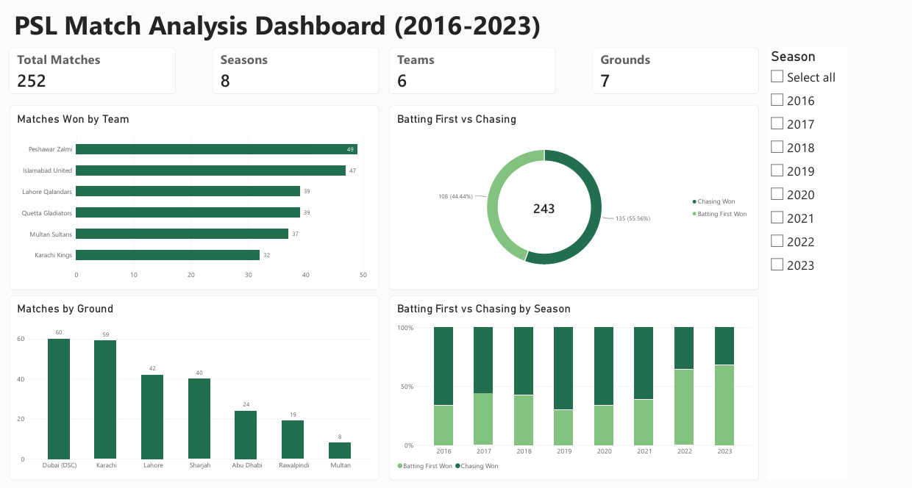

# PSL Match Analysis Dashboard (Power BI)

A Power BI dashboard analyzing 252 PSL matches from 2016 to 2023.

## What I did
- Combined 9 CSV files and cleaned the data in Power Query
- Built KPI cards, 4 charts and a season filter

## Key Insights
- Peshawar Zalmi won the most matches (49)
- Chasing teams won 56% of matches overall

## Tools
Power BI, Power Query, DAX

Dataset: Pakistan Super League Match Results 2015-23 (Kaggle)
